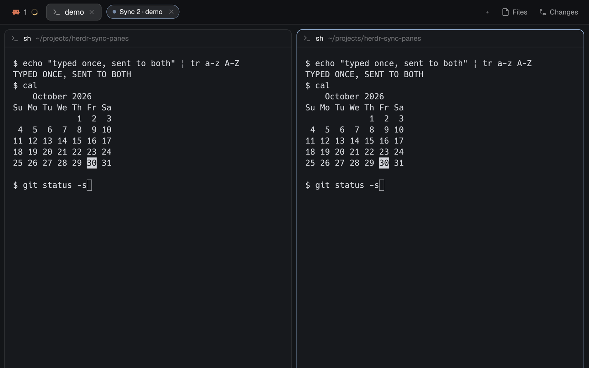

# herdr-sync-panes

A [Herdr](https://herdr.dev) mod: type once, into every terminal of a tab, like tmux's `synchronize-panes`. (It was called Broadcast before.)



- `ctrl-t e` starts syncing in the shown tab; a small "Sync N · <tab>" pill sits in the tab bar. That's this mod's default: tmux has no default key for `synchronize-panes`, so pick your own (below).
- `ctrl-t shift-e` (or the pill's ✕) stops it. Showing another tab stops it too.
- Your other prefix keys keep working, as in tmux: with Herdr's `ctrl-t n` bound to `tab.next`, it goes to the next tab instead of typing `n`.
- Cmd-V pastes the clipboard into every terminal.
- What the pill shows is what it sends: when it says Paused, failed or is gone, nothing still queued is typed anywhere.

## How it differs from tmux

- **The pill holds the keyboard.** Herdr gives mods no way to listen to a terminal's own input, so you type into the pill and it types into the panes. Click a terminal to type into just that one ("Paused"); click the pill to sync again.
- **Japanese and other IME input** doesn't reach the pill; paste it with Cmd-V.
- **Shifted symbols (`!`, `"`, `|`) and non-ASCII go through the clipboard (macOS only).** Your clipboard is put back afterwards, rich text included. A clipboard over about 400 KB (an image) is left alone and those symbols aren't sent. Clipboard managers that honor the nspasteboard.org markers don't record what you type; others might, so don't type secrets while syncing.
- **Zoom:** like tmux, panes you can't see don't get keys.

See [`sync-panes/RECIPE.md`](sync-panes/RECIPE.md) for exactly what it does, how it's built and its limits.

## Install

Ask your agent to add it (it reads `~/.config/herdr-app/AGENTS.md` and the recipe; it renames the mod if the name is taken), or by hand:

```sh
dest=~/.config/herdr-app/mods/sync-panes
if [ -e "$dest" ]; then
  echo "$dest already exists: remove it or install under another name"
else
  cp -R sync-panes/mods/sync-panes "$dest" && herdr-app check "$dest"
fi
```

Then merge [`sync-panes/keys.json`](sync-panes/keys.json) into `~/.config/herdr-app/keys.json`. Check that nothing else already uses those keys; if your prefix isn't `ctrl-t`, change it in both lines. The mod takes its prefix from the `sync-panes.stop` binding, so nothing in `main.js` needs editing. Installing under another folder name means renaming `sync-panes` in `mod.json`'s `key`, in `main.js` (`mod:sync-panes`, `sync-panes.stop`, `mod.open:sync-panes`) and in your keys.

## What it runs

`hc keys` to type into terminals, and `osascript` to borrow and restore the clipboard for characters `hc keys` can't name. It reads no files and makes no network requests.

## License

MIT
