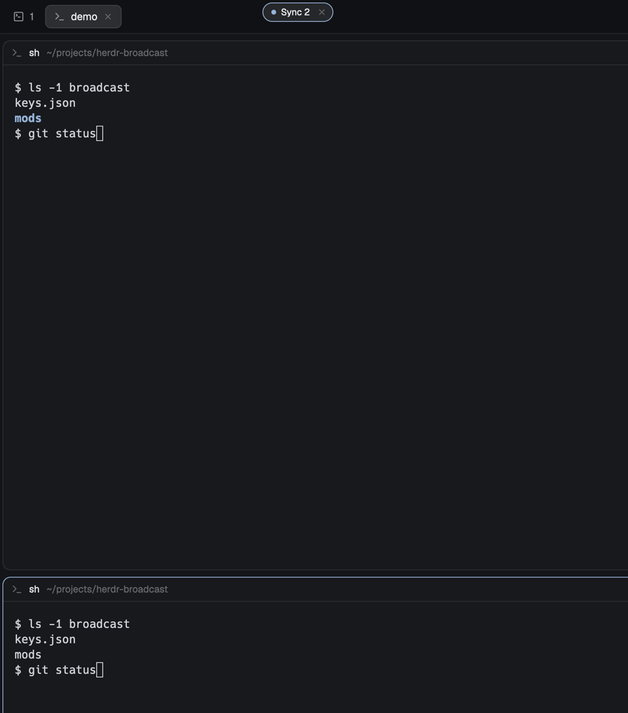

# Broadcast

Type once, into every terminal of the shown tab: tmux's `synchronize-panes` for Herdr. Prefix `e` starts it, prefix `shift-e` stops it, and a small pill sits in the tab bar while it's on. This is a piece you add to your current layout, not a whole window.



This file is the brief: enough to build Broadcast from an empty folder. The files next to it are one build of it. If they don't work on your Herdr, or you want it different, build it again from here.

## What you see

- A pill in the tab bar, about 24px high, at x 600, y 3 in the window. It has no Herdr frame: the pill draws its own rounded 12px border.
- While it holds the keyboard: a 6px dot breathing in the theme's `accent` color (opacity 0.35 → 1 over 1200 ms), "Sync N" (N = terminals in the shown tab) in `foreground`, and a 18px round ✕ on the right. Border in `accent`.
- When the keyboard is elsewhere (you clicked a terminal): the dot and border turn `dim`, the text says "Paused" in `muted`, and the dot stops breathing.
- After a send fails: the dot and border turn `blocked`.
- Text is 11.5px on the theme's `popover` background. Nothing else is added to the layout.

## How it behaves

- `ctrl-t e` opens the pill and gives it the keyboard. Every key you type goes to every terminal pane of the shown tab, in order, as you type it. The tab is read again for each batch, so switching tabs changes where keys go.
- Letters, digits, unshifted ASCII punctuation, Enter, Tab, Backspace, Escape, arrows, Home/End, Page Up/Down, Delete, Insert, F1–F12 and Ctrl/Alt combinations of those go out as named keys.
- Anything else that types a character (shifted symbols like `!`, `"`, `|`, `:`, and non-ASCII) is pasted into each pane: the clipboard is saved, the text is put on it, each pane is focused and pasted into, focus goes back, and the clipboard text is restored.
- Cmd-V pastes the clipboard into every pane.
- Other Cmd shortcuts are ignored. IME composition doesn't reach it; paste Japanese and other composed text with Cmd-V.
- Clicking a terminal takes the keyboard back: the pill shows "Paused" and keys go only to that terminal. Clicking the pill resumes.
- `ctrl-t shift-e`, the ✕, or the pill's own prefix handling stops it. While the pill holds the keyboard, `ctrl-t a` or `ctrl-t ctrl-t` sends a literal Ctrl+T to every terminal, and `ctrl-t e` does nothing.
- Drag the pill anywhere; Herdr remembers the spot (window `key: "broadcast"`).

## Built from

- **One mod**, `mods/broadcast/`, with `main.js` and `mod.json`. The manifest has `place: "none"` and opens as a frameless window overlay (`kind: "window"`, `key: "broadcast"`, `frame: "none"`, `at: {x: 600, y: 3}`), so there is no `layouts/` folder or layout change.
- **A `keys.json` snippet**, merged into the person's keys rather than replacing them:

  ```json
  {
    "global": {
      "ctrl-t e": "mod.open:broadcast",
      "ctrl-t shift-e": "broadcast.stop"
    }
  }
  ```

  `broadcast.stop` reaches the mod through `nextCommand()` and closes it with `closeOverlay(props().overlay)`.
- **A focusable view**: `cx.focus_handle()`, focused in `init` and again after 300 ms, with `track_focus` and `on_key_down` on the pill's root; `handle.is_focused()` decides Sync vs Paused.
- **Targets:** `panes()` filtered to `focused().tab` with a `terminal`.
- **Named keys:** `hc(["keys", terminal, ...names])` for every target in parallel. Key events are translated from GPUI (`escape` → `esc`, uppercase → `shift+a`, `ctrl`/`alt`/`shift` joined with `+`). Keys are queued and merged so a fast typist sends batches, one batch at a time, in order.
- **Text and paste:** `exec("pbpaste")` and `exec("sh", ["-c", 'printf %s "$1" | pbcopy', "sh", text])` around `run("pane.focus", {pane})` + `run("terminal.paste")` for each target, then `pane.focus` back and the pill refocused.
- `PREFIX` / `PREFIX_HC` at the top of `main.js` are the customization point for another prefix.

## Watch out

- `hc keys` takes only named keys: `!`, `"`, `~`, `:` and other shifted symbols are refused, uppercase letters arrive lowercase unless sent as `shift+<letter>`, and `shift+1` types `1`. That's why those go through the clipboard. Don't route all text through `hc send`: it always presses Enter and waits for ~3 s of quiet.
- `hc attach` with piped input doesn't work, and the framed attach stream resizes the terminal, so there is no raw-bytes path from a mod.
- The clipboard path is macOS-only (`pbcopy`, `pbpaste`) and briefly replaces the clipboard; non-text clipboard contents are not restored.
- The mod runs `hc`, `pbcopy`, `pbpaste` and `sh` through `exec`. It reads no files and reaches no network.
- A mod only sees keys while it has focus; there is no API to tap a terminal's own input. That is why the pill must exist while broadcasting.
- `ctrl-t` is this build's prefix. If your prefix differs, change the `keys.json` snippet and `PREFIX` / `PREFIX_HC` together.
- `at: {x: 600, y: 3}` assumes the default `main` layout's tab bar; move it in `mod.json` or drag it once for other layouts.
- Follow the installed `herdr.d.ts` and `gpui-kit.d.ts`; never modify shipped mods.

## Done when

- `herdr-app check mods/broadcast` passes.
- With two shells split in one tab, `ctrl-t e` shows "Sync 2" and typing `ls | grep "a"` + Enter runs the same command in both.
- Arrows, Ctrl+C, Backspace and Tab reach both shells.
- After a symbol is sent, the clipboard's previous text is back.
- Cmd-V pastes the clipboard into both.
- Clicking a terminal shows "Paused"; clicking the pill shows "Sync 2" again.
- `ctrl-t shift-e` and the ✕ both close the pill, and normal typing goes to one terminal again.
