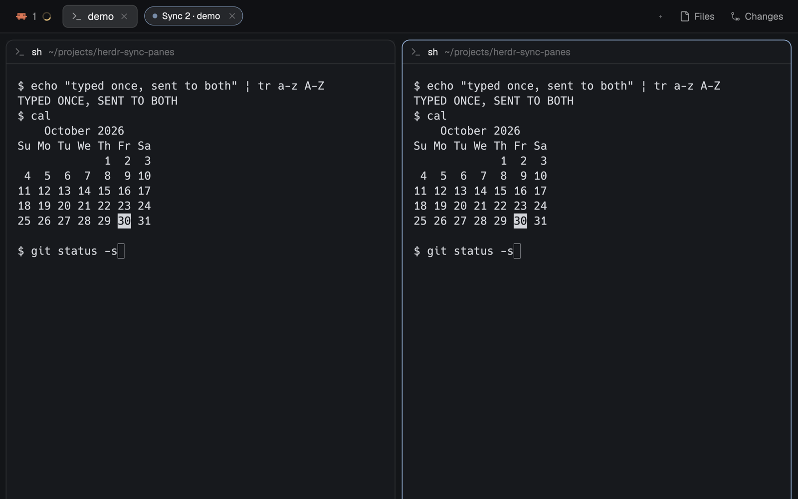

# Sync panes

Type once, into every terminal of one tab: tmux's `synchronize-panes` for Herdr. Prefix `e` starts it, prefix `shift-e` stops it, and a small pill sits in the tab bar while it's on. Your other prefix keys keep working while it's on, as they do in tmux. This is a piece you add to your current layout, not a whole window.



This file is the brief: enough to build Sync panes from an empty folder. The files next to it are one build of it. If they don't work on your Herdr, or you want it different, build it again from here.

## What you see

- A pill in the tab bar, about 24px high, at x 600, y 3 in the window. It has no Herdr frame: the pill draws its own rounded 12px border.
- While it holds the keyboard: a 6px dot breathing in the theme's `accent` color (opacity 0.35 → 1 over 1200 ms), "Sync N · <tab>" (N = terminals it types into, then the tab's name) in `foreground`, and a 18px round ✕ on the right. Border in `accent`.
- When the keyboard is elsewhere (you clicked a terminal): the dot and border turn `dim`, the text says "Paused" in `muted`, and the dot stops breathing.
- When there's no terminal to type into (none in the tab, or a non-terminal pane is zoomed): "No terminals", in `dim`.
- After a send fails: the dot and border turn `blocked`, the text says "Failed t3 · click to resume" (the terminals that failed), and a Herdr notification carries the error.
- Text is 11.5px on the theme's `popover` background. Nothing else is added to the layout.

## How it behaves

**What it shows is what it sends.** Keys are only sent while the pill says "Sync". Everything still queued is dropped when it pauses, stops, leaves its tab, fails, or when the panes it types into change. A key already handed to `hc` can't be called back.

- `ctrl-t e` opens the pill in the shown tab and gives it the keyboard. Every key you type goes to every terminal pane of **that tab**, in order. When a pane in it is zoomed, only that pane counts: a zoomed terminal gets keys alone, a zoomed non-terminal pane (Files, a preview) means nothing gets keys. tmux also skips panes you can't see.
- Showing another tab (or space) ends it: the pill closes. tmux's sync is per window; leaving the window leaves it.
- Panes added to the tab, closed, zoomed or unzoomed change who gets keys from the next key on; keys queued for the old set are dropped.
- Letters, digits, unshifted ASCII punctuation, Enter, Tab, Backspace, Escape, arrows, Home/End, Page Up/Down, Delete, Insert, F1–F12 and Ctrl/Alt combinations of those go out as named keys. Other keys (F13, unusual combinations) are not sent.
- Anything else that types a character (shifted symbols like `!`, `"`, `|`, `:`, and non-ASCII) is pasted into each pane through the clipboard. What was on the clipboard, every type of it (rich text too), is put back afterwards. If you copy something during that half second, your copy is kept instead, except in two short gaps between osascript runs (see Watch out). A clipboard over about 400 KB (usually an image) is never touched: those symbols aren't sent, and it counts as a failure. The typed text carries the nspasteboard.org Transient and Concealed markers, so clipboard managers don't record it.
- Cmd-V pastes the clipboard into every pane.
- Other Cmd shortcuts are ignored. IME composition doesn't reach it; paste Japanese and other composed text with Cmd-V.
- **Paused**: clicking a terminal takes the keyboard; keys go only to that terminal, and nothing queued goes anywhere. Clicking the pill resumes. Pasting a symbol and moving panes with prefix keys move focus for a moment but don't pause.
- **If a send fails** for any terminal, typing is held until you click the pill. Your prefix keys still work meanwhile.
- **Prefix keys run their bindings, as in tmux.** `<prefix> <key>` looks up that chord in `keys.json` (`mod:sync-panes`, then `layout:<shown layout>`, then `global`) and runs it instead of typing the key: `ctrl-t n` goes to the next tab (which ends syncing), `ctrl-t shift-e` stops, a `send:` binding such as `ctrl-t a` → `send:\u0014` types its text into every terminal, an unbound chord does nothing, and so does a `terminal` binding (there's no single program to hand the key to). `ctrl-t e` while it's on does nothing. A half-typed prefix is forgotten on pause, resume, failure and stop.
- **Moving between panes keeps syncing**, as in tmux: after a prefix binding that moves focus to another pane of the tab (`ctrl-t h`, `ctrl-t l`, a "last pane" binding), the pill takes the keyboard back. One that leaves the focused pane as it was (a rename dialog, the palette) keeps the keyboard where Herdr put it.
- `send:` text is typed when every character can be: printable characters, Enter (`\r`, `\n`), Tab, Escape and Ctrl+A–Z. Anything else (NUL, Ctrl+\ ] ^ _, DEL) and nothing is sent; a warning says so.
- The prefix is the first key of the two-key `sync-panes.stop` binding, found in the same sections, in the same order: with `"ctrl-b shift-e": "sync-panes.stop"` the prefix is `ctrl-b`. There's nothing to change in `main.js`.
- `ctrl-t shift-e` or the ✕ stops it.
- Drag the pill anywhere; Herdr remembers the spot (window `key: "sync-panes"`).

## Built from

- **One mod**, `mods/sync-panes/`, with `main.js` and `mod.json`. The manifest has `place: "none"` and opens as a frameless window overlay (`kind: "window"`, `key: "sync-panes"`, `frame: "none"`, `at: {x: 600, y: 3}`), so there is no `layouts/` folder or layout change.
- **A `keys.json` snippet**, merged into the person's keys rather than replacing them:

  ```json
  {
    "global": {
      "ctrl-t e": "mod.open:sync-panes",
      "ctrl-t shift-e": "sync-panes.stop"
    }
  }
  ```

  `sync-panes.stop` reaches the mod through `nextCommand()`. Use your own prefix in both lines; the mod reads it from `keys()`.
- **A focusable view**: `cx.focus_handle()`, focused in `init`, and once more 300 ms later only if the pill hasn't had the keyboard yet (focusing during render isn't allowed). `track_focus` and `on_key_down` on the pill's root; `handle.is_focused()` decides Sync vs Paused.
- **Taking the keyboard back** (`regain()`): Herdr applies `pane.focus` / `pane.go` after the mod's own `handle.focus()` in the same turn, so focusing right away loses. After a paste (if the pill had the keyboard) and after a prefix action that changed `focused().pane`, `cx.timer.after` tries again at 30, 120 and 300 ms, while the tab is the same and the pill doesn't have it, and calls `cx.notify()`: a focus handle changing doesn't redraw the pill by itself. The 300 ms watch timer also redraws whenever focus differs from what was last drawn, so Sync / Paused is never stale.
- **One watch** (`watch()`, on a 300 ms `cx.timer.every`, on every render, before every queued key and before every send): a different `focused().tab` stops; losing the keyboard (outside the 500 ms after a paste moves focus) or a different target set drops the queue. Dropping bumps a generation number; queued items and in-flight clipboard steps carry the generation they were made in and give up when it changed, when stopped, or when the tab changed.
- **Targets:** `panes()` in that tab; if one is `zoomed`, just it when it has a `terminal`, else none; otherwise those with a `terminal`. Each queued item keeps the targets of the moment it was typed, and items only merge with the same targets.
- **Named keys:** `hc(["keys", terminal, ...names])` for every target, awaited with `Promise.allSettled` so the next batch never starts before every target answered. A non-zero exit or a rejection fails: the failing terminals and hc's `error.message` are kept until the pill is clicked.
- **Prefix:** the first key of a two-key `sync-panes.stop` binding in `keys()`, by section as above. The prefix is remembered when pressed; the next key is looked up in `keys()` and run with `run()`; `name:value` actions pass the value as the command's first argument from `commands()` (digits as numbers).
- **Text and paste:** two JXA scripts run with `exec("/usr/bin/env", [VAR=value…, "osascript", "-l", "JavaScript", "-e", script])`; values go in the environment, never as arguments, so clipboard contents starting with `-` can't become osascript options. The first saves every pasteboard type's data (base64, at most 400,000 characters in all, else `TOOBIG` and nothing changes), sets the text with `org.nspasteboard.TransientType` and `ConcealedType`, and returns the saved data and `changeCount`. Then `run("pane.focus", {pane})` + `run("terminal.paste")` for each target, if still alive; in `finally` focus goes back to the pane it came from, the pill is refocused only if it had the keyboard, and the second script restores the saved types (marked Transient) only if `changeCount` is unchanged.
- On-screen words are in the `LABEL` table at the top of `main.js`.

## Watch out

- `hc keys` takes only named keys: `!`, `"`, `~`, `:` and other shifted symbols are refused, uppercase letters arrive lowercase unless sent as `shift+<letter>`, and `shift+1` types `1`. That's why those go through the clipboard. Don't route all text through `hc send`: it always presses Enter and waits for ~3 s of quiet.
- `hc attach` with piped input doesn't work, and the framed attach stream resizes the terminal, so there is no raw-bytes path from a mod. That is also why the clipboard is borrowed at all.
- The clipboard can't be locked. A copy you make in the instant between the first script reading the clipboard and writing it, or between the second script's `changeCount` check and its restore, is overwritten. Outside those instants it's kept.
- `run()` returns nothing, so the mod can't tell whether a paste landed, only that it asked.
- The clipboard path is macOS-only (`osascript`). Clipboard managers that ignore the nspasteboard.org markers may still see typed characters: don't type secrets while syncing.
- The mod runs `hc` and `osascript` through `exec`. It reads no files and reaches no network.
- A mod only sees keys while it has focus; there is no API to tap a terminal's own input. That is why the pill must exist while syncing, and why it isn't tmux's "keep typing in the pane" feel.
- Whether Herdr's own bindings or the pill's key handler sees a chord first hasn't been settled; the mod handles prefix chords itself so they behave the same either way. Check `ctrl-t shift-e` on your Herdr after installing.
- Bind `sync-panes.stop` under your prefix as a two-key sequence. With a single-key binding the mod has no prefix, and the pill takes every key itself, so that key may not reach Herdr; use the ✕ then.
- `at: {x: 600, y: 3}` assumes the default `main` layout's tab bar; move it in `mod.json` or drag it once for other layouts.
- Follow the installed `herdr.d.ts` and `gpui-kit.d.ts`; never modify shipped mods.

## Done when

- `herdr-app check mods/sync-panes` passes.
- With two shells split in one tab, `ctrl-t e` shows "Sync 2 · <tab>" and typing `ls | grep "a"` + Enter runs the same command in both.
- Arrows, Ctrl+C, Backspace and Tab reach both shells.
- After a symbol is sent, the clipboard holds what it held before (rich text stays rich), and a clipboard manager's history doesn't show the symbol. With an image on the clipboard, a symbol isn't sent and the image is still there.
- Cmd-V pastes the clipboard into both.
- Clicking a terminal shows "Paused" and typing goes only there; clicking the pill shows "Sync 2 · <tab>" again.
- Typing `ls |` keeps "Sync 2 · <tab>", and the next keys still reach both shells.
- `ctrl-t h` and `ctrl-t l` between the two shells keep "Sync 2 · <tab>", and typing still reaches both.
- `ctrl-t n` while syncing goes to the next tab and the pill closes; nothing typed before reaches the new tab.
- Zooming one shell makes the pill say "Sync 1" and only that shell gets keys; zooming a Files or preview pane makes it say "No terminals".
- Killing one of the shells from outside and typing shows "Failed …"; nothing more is typed anywhere until the pill is clicked.
- `ctrl-t a` types a literal Ctrl+T into both; an unbound `ctrl-t <key>` types nothing.
- With the bindings moved to `ctrl-b` in `keys.json` only, `ctrl-b shift-e` stops it.
- `ctrl-t shift-e` and the ✕ both close the pill, and normal typing goes to one terminal again.
